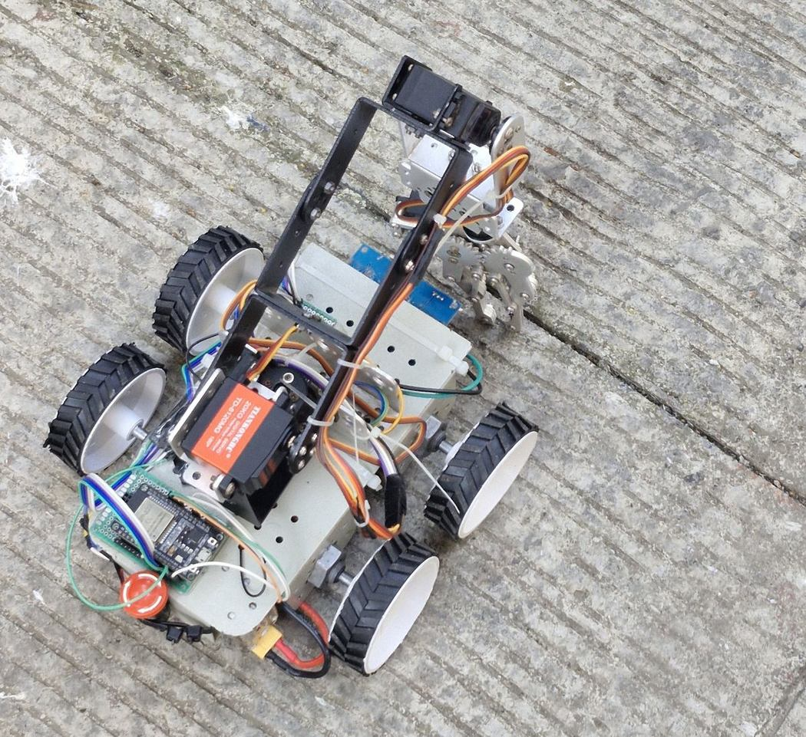
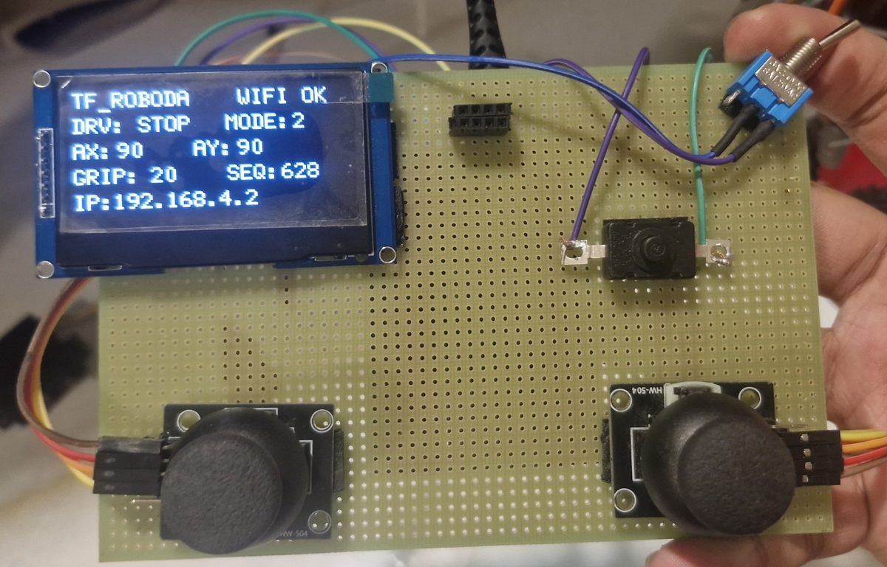

# Mobile Manipulator

A four-wheeled rover with a five-servo arm and gripper claw, driven over Wi-Fi by a handheld ESP32-S3 controller with two joysticks, an OLED status screen and a mode switch.

Two boards, one 17-byte UDP packet, no router needed: the rover raises its own access point and the controller joins it.



<p align="center">
  
</p>

## Architecture

```
  ESP32-S3 controller                    ESP32 rover
  ┌──────────────────────┐               ┌──────────────────────┐
  │  drive joystick      │               │  Wi-Fi AP            │
  │  arm joystick        │   UDP :4210   │  192.168.4.1         │
  │  mode switch         │ ────────────► │  UDP receiver        │
  │  gripper switch      │  17 B packet  │      │               │
  │  OLED + NeoPixel     │               │      ├─ L298N motors │
  └──────────────────────┘               │      └─ 5 servos     │
         joins AP, gets 192.168.4.x       └──────────────────────┘
```

- The rover runs a **soft access point** (`WiFi.softAP`, hidden off, one station) and listens on UDP port **4210**.
- The controller joins that AP as a station and sends to `192.168.4.1:4210` from its own port **4211**.
- Control runs at **25 Hz** (40 ms loop). On the rover, anything older than **300 ms** is treated as lost and the motors stop.

## Repository layout

```
mobile-manipulator/
├── rover/
│   └── esp32-rover-wifi-arm-dcdriver/
│       └── esp32-rover-wifi-arm-dcdriver.ino       # motors, servos, UDP receiver
├── controller/
│   └── esp32s3-controller-oled-wifi-tx-2joy-mode-claw/
│       └── esp32s3-controller-oled-wifi-tx-2joy-mode-claw.ino
└── images/
```

Both folders are complete Arduino sketches: open them directly in the IDE, or build with `arduino-cli`. The directory names match the `.ino` files, as the Arduino toolchain requires.

## Packet format

`CommandPacket` is `#pragma pack(1)` and checked with `static_assert(sizeof(CommandPacket) == 17)` on both sides, so the two sketches cannot silently drift apart.

| Offset | Field | Type | Notes |
|---:|---|---|---|
| 0 | `auth` | `uint32_t` | `AUTH_TOKEN`, must match on both boards |
| 4 | `session` | `uint32_t` | random per controller boot; a new value resets the sequence |
| 8 | `sequence` | `uint32_t` | increments every packet, rollover-safe |
| 12 | `drive` | `int8_t` | 0 stop, 1 forward, 2 backward, 3 left, 4 right |
| 13 | `mode` | `uint8_t` | 0 base+shoulder, 1 elbow+wrist |
| 14 | `armX` | `uint8_t` | 0-180 degrees |
| 15 | `armY` | `uint8_t` | 0-180 degrees |
| 16 | `gripper` | `uint8_t` | 0 open, up to 90 closed |

Every packet is validated in this order: exact length, auth token, command range, then session and sequence. Malformed, unauthorised, stale and duplicate packets are dropped before any motor or servo is touched.

## Rover pin map

| Function | Pin |
|---|---|
| L298N IN1 / IN2 / IN3 / IN4 | 4 / 5 / 6 / 7 |
| Arm base servo | 13 |
| Arm shoulder servo | 14 |
| Arm elbow servo | 8 |
| Arm wrist servo | 9 |
| Gripper servo | 10 |

Servos run at 50 Hz with a 500-2500 us pulse range, all five attached at boot. The arm starts at 90 degrees on every joint and the gripper starts open. Motors start stopped.

## Controller pin map

| Function | Pin |
|---|---|
| Drive joystick X / Y | 1 / 2 |
| Arm joystick X / Y | 5 / 6 |
| Mode switch | 15 |
| Gripper switch | 16 |
| OLED SCK / MOSI / CS / DC / RST | 12 / 11 / 10 / 9 / 8 |
| NeoPixel RGB | 48 |

The OLED is an SSD1309 128x64 on hardware SPI, driven by U8g2 (`U8G2_SSD1309_128X64_NONAME0_F_4W_HW_SPI`). It shows Wi-Fi state, drive command, arm mode, both arm angles, gripper angle, packet sequence and the controller's IP. The single NeoPixel is the link light: **red** connecting, **blue** connected, **green** packet sent.

## Controls

**Drive** - the left joystick. Forward, backward, left and right, with a 1600-2000 ADC dead zone around centre. Diagonal positions are ignored, so only one drive command is ever active.

**Arm** - the right joystick, with the mode switch choosing which pair of joints it drives:

| Mode switch | OLED | Joints |
|---|---|---|
| LOW | MODE 1 | base (X) and shoulder (Y) |
| HIGH | MODE 2 | elbow (X) and wrist (Y) |

Each axis maps 0-1600 to 0-80 degrees, 1600-2000 to a 90 degree centre, and 2000-4095 to 90-180 degrees, so the stick self-centres the joint.

**Gripper** - the second switch, pressed for closed and released for open. The controller sends 20 and 120 degrees; the rover clamps the gripper to 90 degrees, so the claw parks at 90 when open.

## Failsafe

Communication loss does not leave the rover driving. After **300 ms** without a valid packet the rover:

1. stops both motors,
2. holds the arm at its last commanded angles,
3. holds the gripper where it is,
4. prints `!!! FAILSAFE ACTIVATED !!!` on serial and waits.

The servos stay attached and powered, so the arm does not drop, and the rover resumes on the next valid packet without a reboot. If Wi-Fi drops on the controller it shows `WIFI LOST / RECONNECTING` on the OLED, turns the NeoPixel red and rejoins the AP in a loop.

## Build

Arduino IDE 2.x or `arduino-cli`.

| Board | Core | Libraries |
|---|---|---|
| Rover ESP32 | `esp32` | `ESP32Servo` |
| Controller ESP32-S3 | `esp32` | `U8g2`, `Adafruit NeoPixel` |

`WiFi` and `WiFiUdp` ship with the ESP32 core.

```sh
arduino-cli core install esp32:esp32
arduino-cli lib install ESP32Servo U8g2 "Adafruit NeoPixel"
```

Then flash the rover, then the controller. Power the rover first: it has to be broadcasting before the controller can join.

## Configuration

Both sketches carry the same three values near the top and they must stay in sync:

```cpp
const char* AP_SSID = "MobileManipulator";
const char* AP_PASS = "YOUR_AP_PASSWORD";
const uint32_t AUTH_TOKEN = 0x5EEDC0DE;
```

Set your own password before flashing (WPA2 needs 8+ characters) and keep it out of the repository. Change the SSID too if you run more than one rover. The token is not real security, it only rejects stray traffic on the same channel; treat the link as a short-range private network and keep the rover in sight.

To run more than one rover in the same room, give each a different SSID and channel.

## Notes and gotchas

- The rover AP broadcasts on **channel 1** with a single station allowed. A second controller cannot join while the first is connected.
- `WiFi.setSleep(false)` is set on both sides; without it, latency spikes badly at 25 Hz.
- The drive joystick is read with `ADC_11db` attenuation, which is the full 0-3.3 V range on the ESP32-S3.
- Turn commands drive one side only, so steering is a pivot rather than a curve. Swap the IN3/IN4 wiring, or `turnLeft()` and `turnRight()`, if your chassis is mirrored.
- The rover accepts any source address once the token matches; there is no pairing or encryption.
- `session` is seeded from `esp_random()` at controller boot, so a controller reset is picked up immediately instead of waiting for the sequence to catch up.

## License

MIT.
